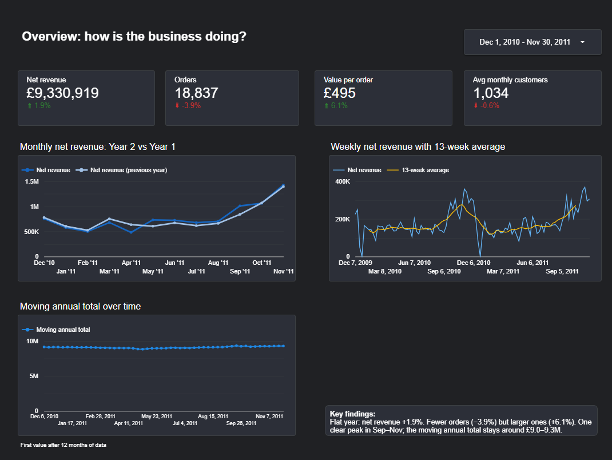

# Retail Statistical Analytics

End-to-end statistical analysis of two years of transactions (about one million order lines) from a UK online
giftware wholesaler: trends, seasonality, drivers, segmentation, market-basket analysis, forecasting,
classification, anomaly detection, hypothesis testing and experiment design.

Every business question is answered **twice, in Python and in R**, from the same cleaned data, and the two
implementations are reconciled ([docs/04_reconciliation.md](docs/04_reconciliation.md)).

**Live dashboard:** [Looker Studio report](https://datastudio.google.com/reporting/f4108bc3-ed9f-4531-ad69-5212a8e33b36) ·
**Findings:** [docs/03_findings.md](docs/03_findings.md)

## Key findings

| # | Question | Answer |
|---|---|---|
| BQ1 | How is the business trending? | **Flat.** Net revenue +1.9% year on year, not significant once seasonality is controlled; fewer but larger orders |
| BQ2 | What repeats? | **One strong yearly peak.** Sep–Nov brings 36–38% of annual revenue; a business week (closed Saturdays) and office hours |
| BQ3 | What drives value and cancellations? | **Order frequency** predicts next-year value; cancellations are driven by **mispricing** (odds ×17.8), not large orders |
| BQ4 | Which segments exist? | **17% of customers bring 65% of revenue**; a "mid-value, cooling" group (£1.9M) is the main retention opportunity |
| BQ5 | What is bought together? | **Variants of the same range** (herb markers, Regency teaware): customers buy the set |
| BQ6 | What comes next? | **Next quarter ≈ £1.9M**; models beat "same week last year" only slightly (WAPE 14.8% vs 15.7%); repeat purchase AUC 0.75 |
| BQ7 | What is unusual? | **7 of 596 days**, mostly calendar effects; unusual invoices are single-line manual non-product entries |
| BQ8 | Are differences real; how to test a campaign? | Non-UK orders **1.6× larger**; a win-back A/B test needs **about 1,500 customers per group** for a +5-point lift |

Recommendations, limitations and the detail behind each answer are in [docs/03_findings.md](docs/03_findings.md).

## Dashboard

The [Looker Studio report](https://datastudio.google.com/reporting/f4108bc3-ed9f-4531-ad69-5212a8e33b36) presents the
results in seven pages, one question each: Overview, Seasonality, Customers, Products, Drivers and risk, Forecast,
Anomalies and tests.



The notebooks write summary tables to `reports/dashboard_data/`; `src/publish_to_sheets.py` copies them to a Google
Sheet that the report reads. See [docs/05_dashboard.md](docs/05_dashboard.md).

## Repository structure

```
retail-statistical-analytics/
├── data/                      raw and processed data (not in Git; created by the scripts)
├── docs/
│   ├── 01_problem_statement.md   business questions, hypotheses, methods
│   ├── 02_data_quality_findings.md   data quality review, decision log T1–T17
│   ├── 03_findings.md        executive summary, recommendations, BQ1–BQ8
│   ├── 04_reconciliation.md  Python–R comparison
│   └── 05_dashboard.md       dashboard setup and design
├── notebooks/                 01 profiling; 02–08 one Python and one R notebook per business question
├── r/install_packages.R       R packages
├── reports/
│   ├── dashboard_data/        summary tables written by the notebooks (CSV)
│   ├── deliverables/          public previews of the client workbook and findings deck
│   └── figures/               charts saved by the notebooks; dashboard screenshots
├── src/
│   ├── download_data.py       download the dataset from UCI
│   ├── clean_data.py          cleaning rules T1–T17 → data/processed/
│   ├── publish_to_sheets.py   publish dashboard tables to Google Sheets
│   └── build_workbook.py      build the client Excel workbook
└── requirements.txt           Python packages (pinned)
```

## How to reproduce

### 1. Environment

The analysis was run on **Windows 11 with WSL 2 (Ubuntu 24.04)**: Python 3.12 and R 4.6, both as Jupyter kernels in
VS Code. Any Linux or macOS machine with the same versions should work.

```bash
# Python
python3 -m venv ~/venvs/stats
~/venvs/stats/bin/pip install -r requirements.txt
~/venvs/stats/bin/python -m ipykernel install --user --name stats-wsl --display-name "Python 3.12 (WSL stats)"

# R (needs R 4.6; build tools and libcurl/libssl/libxml2 headers for some packages)
Rscript r/install_packages.R
Rscript -e 'IRkernel::installspec(name = "ir", displayname = "R (WSL)")'
```

### 2. Run order

Run from the project folder. Each notebook reads only `data/processed/` and writes to `reports/`.

| Step | Run | Produces |
|---|---|---|
| 1 | `python src/download_data.py` | `data/raw/online_retail_ii.parquet` |
| 2 | `python src/clean_data.py` | `data/processed/` (cleaned order lines; 18 output checks must pass) |
| 3 | `notebooks/01_profiling.ipynb` | Data profile (optional: documents the raw data) |
| 4 | `02_trend_seasonality_py` → `_r` | BQ1–BQ2 |
| 5 | `03_drivers_py` → `_r` | BQ3 |
| 6 | `04_segmentation_py` → `_r` | BQ4 |
| 7 | `05_market_basket_py` → `_r` | BQ5 |
| 8 | `06_forecast_repeat_py` → `_r` | BQ6 |
| 9 | `07_anomalies_py` → `_r` | BQ7 |
| 10 | `08_hypothesis_ab_py` → `_r` | BQ8 |
| 11 | `python src/publish_to_sheets.py` | Google Sheet for the dashboard (needs your own service account; see [docs/05_dashboard.md](docs/05_dashboard.md)) |
| 12 | `python src/build_workbook.py reports/dashboard_data <output.xlsx>` | Client Excel workbook |

Within each business question, run the **Python notebook before the R notebook**: the last cell of each R notebook
reads the Python results and compares them.

Random seeds are fixed (42). Expected differences between Python and R (k-means starts, Isolation Forest, bootstrap,
ARIMA optimisers) are listed in [docs/04_reconciliation.md](docs/04_reconciliation.md).

## Progress

| Stage | Output | Status |
|---|---|---|
| 1. Project setup | Folder structure, `.gitignore`, `src/download_data.py`, Python environment | ✅ Done |
| 2. Version control | Git history on GitHub | ✅ Done |
| 3. Problem framing | [docs/01_problem_statement.md](docs/01_problem_statement.md) | ✅ Done |
| 4. Data profiling | [notebooks/01_profiling.ipynb](notebooks/01_profiling.ipynb) | ✅ Done |
| 5. Data quality review | [docs/02_data_quality_findings.md](docs/02_data_quality_findings.md), decision log T1–T17 | ✅ Done |
| 6. Data cleaning | [src/clean_data.py](src/clean_data.py) → `data/processed/`, 18 output checks | ✅ Done |
| 7. R environment | [r/install_packages.R](r/install_packages.R), R Jupyter kernel | ✅ Done |
| 8. BQ1–BQ2 Trend and seasonality | [Python](notebooks/02_trend_seasonality_py.ipynb), [R](notebooks/02_trend_seasonality_r.ipynb), [findings](docs/03_findings.md) | ✅ Done |
| 9. BQ3 Drivers of value and cancellation | [Python](notebooks/03_drivers_py.ipynb), [R](notebooks/03_drivers_r.ipynb), [findings](docs/03_findings.md) | ✅ Done |
| 10. BQ4 Segmentation | [Python](notebooks/04_segmentation_py.ipynb), [R](notebooks/04_segmentation_r.ipynb), [findings](docs/03_findings.md) | ✅ Done |
| 11. BQ5 Market basket | [Python](notebooks/05_market_basket_py.ipynb), [R](notebooks/05_market_basket_r.ipynb), [findings](docs/03_findings.md) | ✅ Done |
| 12. BQ6 Forecasting and repeat purchase | [Python](notebooks/06_forecast_repeat_py.ipynb), [R](notebooks/06_forecast_repeat_r.ipynb), [findings](docs/03_findings.md) | ✅ Done |
| 13. BQ7 Anomalies | [Python](notebooks/07_anomalies_py.ipynb), [R](notebooks/07_anomalies_r.ipynb), [findings](docs/03_findings.md) | ✅ Done |
| 14. BQ8 Hypothesis testing and experiment design | [Python](notebooks/08_hypothesis_ab_py.ipynb), [R](notebooks/08_hypothesis_ab_r.ipynb), [findings](docs/03_findings.md) | ✅ Done |
| 15. Python–R reconciliation | [docs/04_reconciliation.md](docs/04_reconciliation.md) | ✅ Done |
| 16. Findings | [docs/03_findings.md](docs/03_findings.md): executive summary, recommendations, BQ1–BQ8 | ✅ Done |
| 17. Dashboard | [Looker Studio report](https://datastudio.google.com/reporting/f4108bc3-ed9f-4531-ad69-5212a8e33b36) (7 pages), [setup and design](docs/05_dashboard.md), [src/publish_to_sheets.py](src/publish_to_sheets.py) | ✅ Done |
| 18. Client deliverable and presentation | Public previews: [Excel workbook](reports/deliverables/retail_analytics_client_workbook__.xlsx) (Summary and BQ1–BQ3; built by [src/build_workbook.py](src/build_workbook.py)) and [findings deck](reports/deliverables/retail_analytics_findings__.pptx) (first 4 of 13 slides). Full versions available on request | ✅ Done |
| 19. Reproducibility | [requirements.txt](requirements.txt), [r/install_packages.R](r/install_packages.R), run order (above) | ✅ Done |

## Tools

Python (pandas, statsmodels, scikit-learn, SciPy, mlxtend, Prophet, XGBoost) · R (dplyr, sandwich/lmtest, rpart,
cluster, arules, prophet, xgboost, isotree) · Jupyter in VS Code on WSL · Google Sheets API and Looker Studio ·
Excel (openpyxl) · Git and GitHub

## Data and licence

Chen, D. (2012). *Online Retail II* [Dataset]. UCI Machine Learning Repository.
https://doi.org/10.24432/C5CG6D

Used under the [Creative Commons Attribution 4.0 International (CC BY 4.0)](https://creativecommons.org/licenses/by/4.0/)
licence. The data is not stored in this repository; run `python src/download_data.py` to download it.
