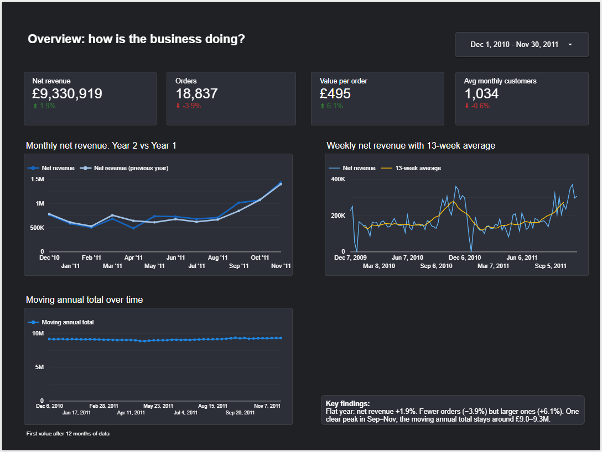
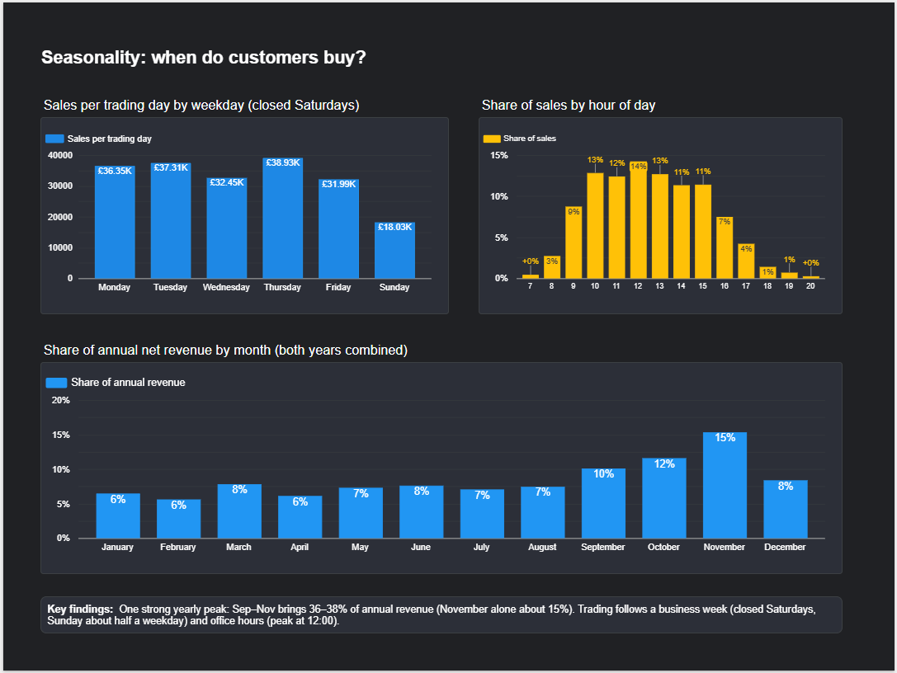
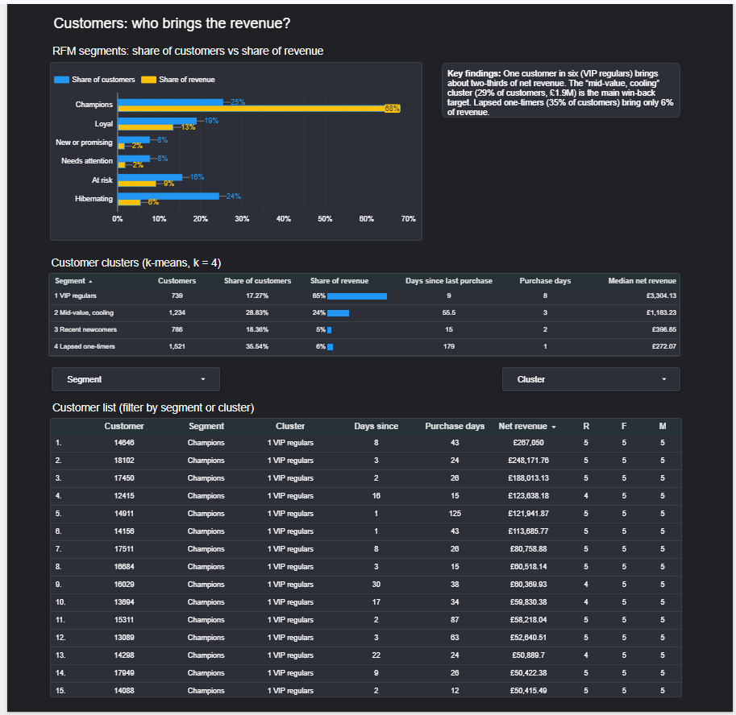
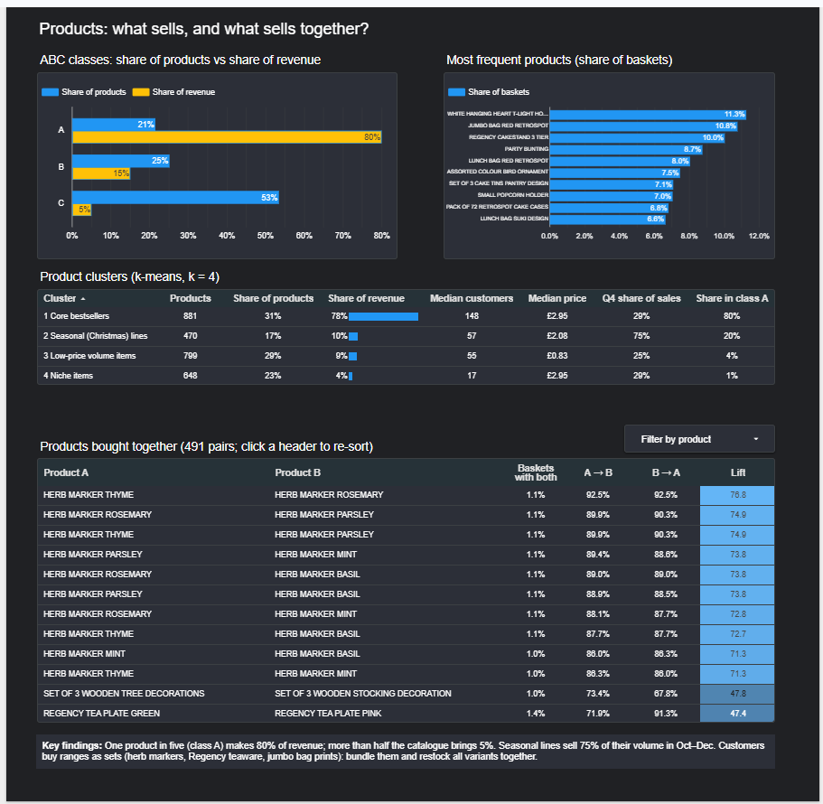
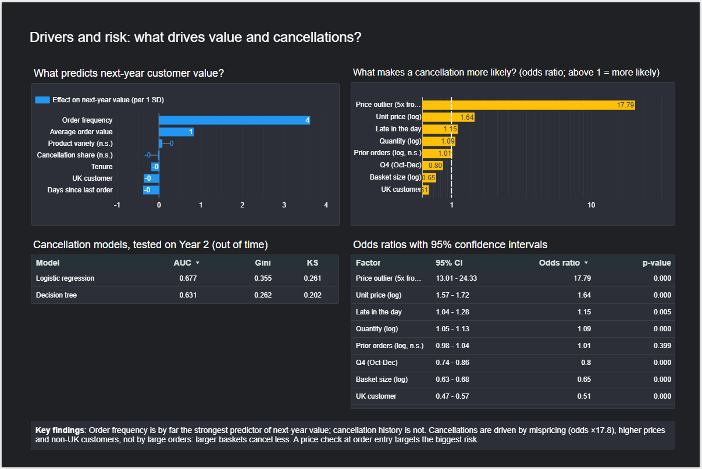
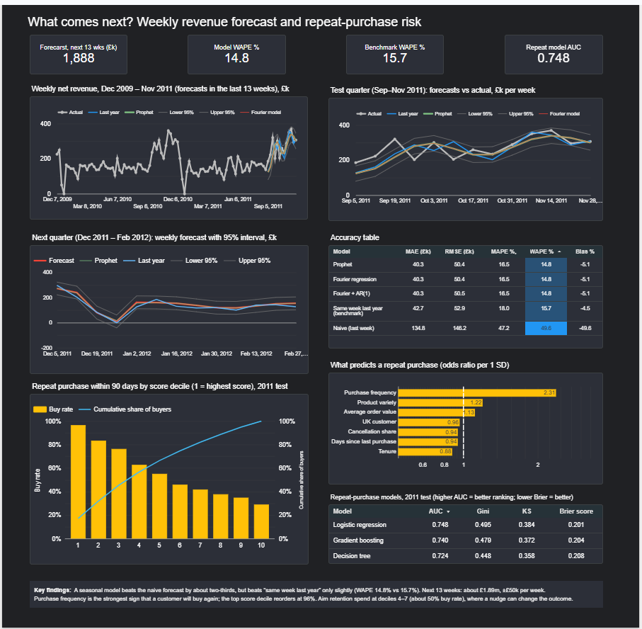
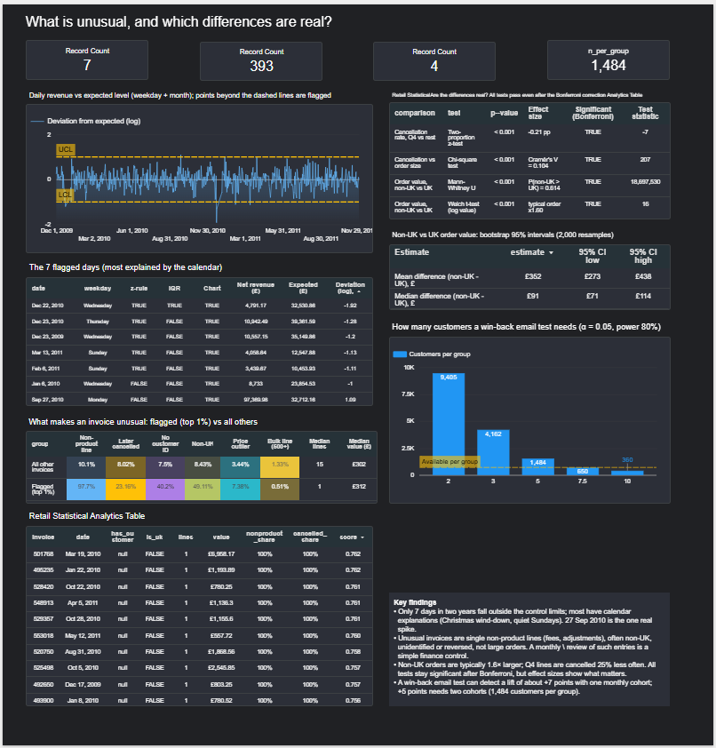

# 05 Dashboard: Google Sheets → Looker Studio

**Live report:** [Retail Statistical Analytics (Looker Studio)](https://datastudio.google.com/reporting/f4108bc3-ed9f-4531-ad69-5212a8e33b36), view-only.

The notebooks write summary tables to `reports/dashboard_data/` (one CSV per table). `src/publish_to_sheets.py`
copies them into one Google Sheet, one tab per table, and Looker Studio reads that Sheet. Re-running the notebooks and
the script refreshes the dashboard; the Looker Studio report itself does not need to change.

```
notebooks (Python) ──► reports/dashboard_data/*.csv ──► publish_to_sheets.py ──► Google Sheet ──► Looker Studio
```

## One-time setup

### 1. Google Cloud service account

1. Go to <https://console.cloud.google.com/> and create a project, e.g. `retail-dashboard`.
2. **APIs & Services → Library**: enable **Google Sheets API** and **Google Drive API**.
3. **APIs & Services → Credentials → Create credentials → Service account**: name it e.g. `sheets-publisher`; no roles are needed.
4. Open the service account → **Keys → Add key → Create new key → JSON**. A `.json` file downloads.
5. Save it in the project as `.secrets/service_account.json`. The `.secrets/` folder is in `.gitignore`: the key must never be committed.
6. Note the service account's e-mail address (`...@<project>.iam.gserviceaccount.com`).

### 2. The Google Sheet

1. Create an empty Google Sheet, e.g. **Retail Statistical Analytics – dashboard data**.
2. **Share** it with the service account e-mail as **Editor**.
3. Copy the Sheet ID: the long code between `/d/` and `/edit` in its URL. Save it in `.secrets/sheet_id.txt`.

### 3. Python package (WSL environment)

```bash
~/venvs/stats/bin/pip install gspread
```

## Publishing

```bash
~/venvs/stats/bin/python src/publish_to_sheets.py --dry-run     # list the tables, no Google access
~/venvs/stats/bin/python src/publish_to_sheets.py               # publish
```

Each run replaces the contents of every tab and updates the `_about` tab with the time of publication.
`anomaly_invoice_scores.csv` (one score per invoice) is excluded: it is used for the Python–R check, not the dashboard.

## Report design

Seven pages, one business question each. Each tab becomes a Looker Studio data source (**Add data → Google Sheets →
the Sheet → tab**, with "Use first row as headers" ticked).

| Page | Question | Charts | Tables (tabs) |
|---|---|---|---|
| 1. Overview | How is the business doing? | Scorecards (net revenue, orders, value per order, customers); monthly net revenue, Year 1 vs Year 2; weekly revenue | `monthly_kpis`, `weekly_revenue` |
| 2. Seasonality | When do customers buy? | Revenue by weekday and by hour | `weekday_pattern`, `hour_pattern` |
| 3. Customers | Who are the customers? | RFM segments: share of customers vs revenue; cluster profiles; filterable customer table | `customer_rfm_segments`, `customer_clusters`, `customer_rfm` |
| 4. Products | What sells, and together? | ABC classes; product clusters; top product pairs by lift and support | `product_abc`, `product_clusters`, `basket_pairs`, `basket_rules`, `basket_top_products` |
| 5. Drivers and risk | What drives value and cancellations? | Value drivers (effect per SD); cancellation odds ratios (reference line at 1); model performance | `value_drivers`, `cancellation_odds`, `cancellation_model_performance` |
| 6. Forecast | What comes next? | Scorecards (next-quarter total, model vs benchmark WAPE, repeat AUC); weekly actual vs forecasts, full history and test quarter; next-quarter forecast with 95% interval; accuracy table; repeat-purchase gains by decile; repeat odds ratios; model performance | `forecast_weekly`, `forecast_next_quarter`, `forecast_accuracy`, `repeat_gains`, `repeat_odds`, `repeat_performance` |
| 7. Anomalies and tests | What is unusual; which differences are real? | Scorecards (days and invoices flagged, significant tests, A/B sample size); daily residuals with control limits; flagged days; flagged-vs-normal profile; top anomalous invoices; hypothesis tests; bootstrap intervals; A/B sample sizes with the available sample as a reference line | `anomaly_daily_residuals`, `anomaly_days`, `anomaly_invoices_top`, `anomaly_profile`, `hypothesis_tests`, `bootstrap_intervals`, `ab_sample_size` |

Every page ends with a **Key findings** card that states the answer in four lines.

**Style:** a dark theme with light text and the same accent colours as the notebook charts (blue `#64B5F6`, orange
`#FF8A65`, green `#81C784`); one question per page, stated in the page title; units in chart titles.

## Screenshots

| | |
|---|---|
|  |  |
|  |  |
|  |  |
|  | |

## Field types

Set after connecting each tab (data source → field list → **Type**):

| Kind of column | Type | Example |
|---|---|---|
| Dates (`month`, `week`, `date`) | Date | `forecast_weekly.week` |
| Shares stored as fractions (0.25) | Percent | `buy_rate`, `has_nonproduct` |
| Percentages already ×100 (14.8) | **Number**, with a `%` suffix | `forecast_accuracy.WAPE`, `MAPE`, `bias_pct` |
| Multiples | Number | `ab_sample_size.share_of_eligible` |
| Revenue | Currency (GBP) | `bootstrap_intervals.estimate` |
| IDs | **Text** (otherwise Looker sums them) | `anomaly_invoices_top.invoice` |
| Counts and medians | Number, 0 decimals | `anomaly_profile.median_lines` |

## Lessons from building the report

Looker Studio behaviours that cost time, and the settings that solved them:

| Symptom | Cause | Fix |
|---|---|---|
| Weekly line shows dots only | Granularity **Date** fills every calendar day, and *Missing data = Line breaks* cuts the line at each empty day | Granularity **ISO Year Week** for weekly data |
| Forecast lines start at week 1 or drop to 0 | Forecasts exist only in the test weeks | *Missing data = Line breaks* (forecast charts); *Linear interpolation* for daily data with closed days |
| Chart shows "No data" for Dec 2011 – Feb 2012 | A fixed report date range (Dec 2010 – Nov 2011) applies | *Default date range = Auto* on charts outside that window |
| Values about 4× too high | Weekly rows summed into months (granularity Year Month) | Match the granularity to the table's grain |
| Chart colours on the wrong series | Style colours belong to the series position, not the field | Order the metrics first, then set colours |
| No box for an axis title | Looker prints metric names only | Units in the chart title; rename metrics |
| "Invalid configuration" on a comparison chart | Comparison does not work with *Group others* | Turn *Group others* off |
| p-values shown as 0.000 | p < 10⁻⁶ | Calculated text field: `CASE WHEN p_value < 0.001 THEN "< 0.001" ELSE CAST(ROUND(p_value, 3) AS TEXT) END` |
| A column has no name | pandas index without a name became a blank header | `rename_axis("group")` before `to_csv` (notebook 07) |
| Boolean column shows `null` | The field was set to Boolean | Set the field to Text (shows TRUE / FALSE) |
| A filter control does nothing | Controls filter only charts on the same data source | Use one data source per filtered group of charts |
| Copied chart breaks on a new page | Its filters or calculated fields refer to the old data source | After copying: check *Filter*, then switch the data source and replace red (invalid) fields |
